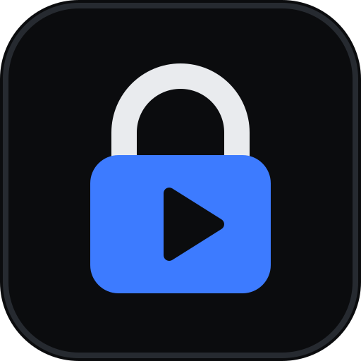
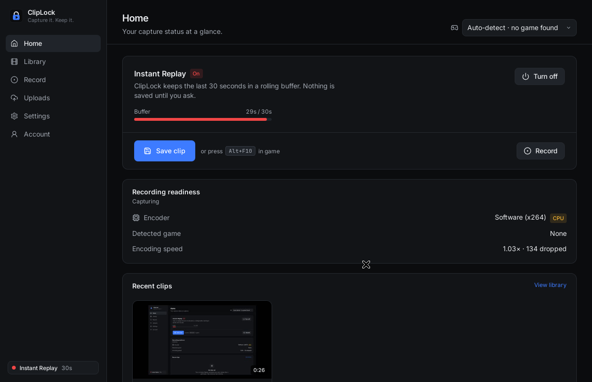
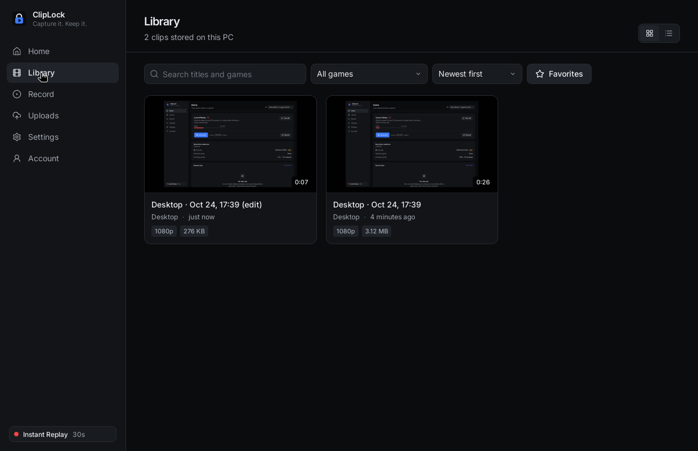
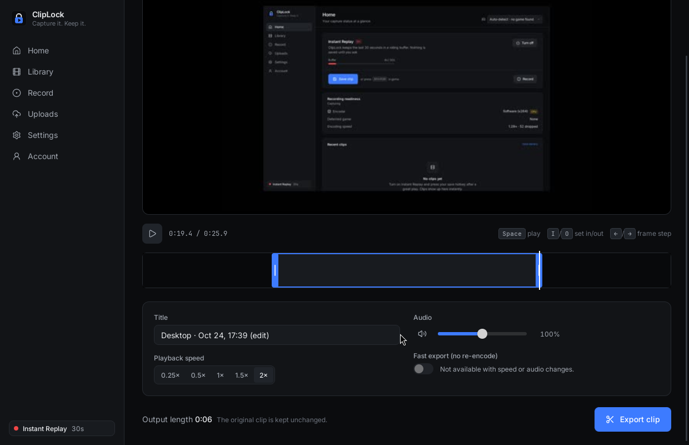
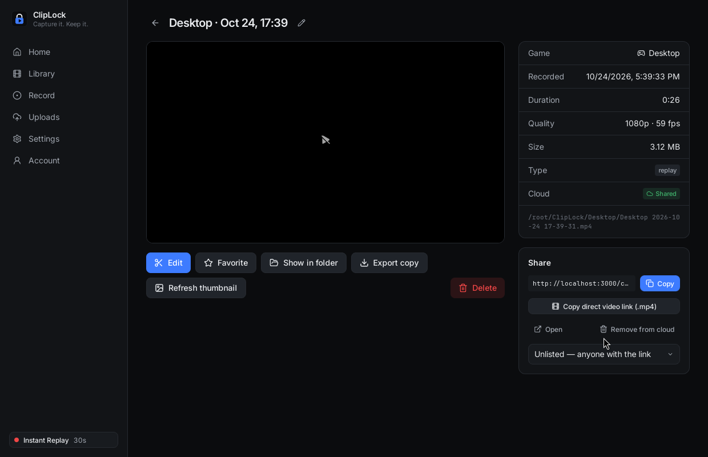
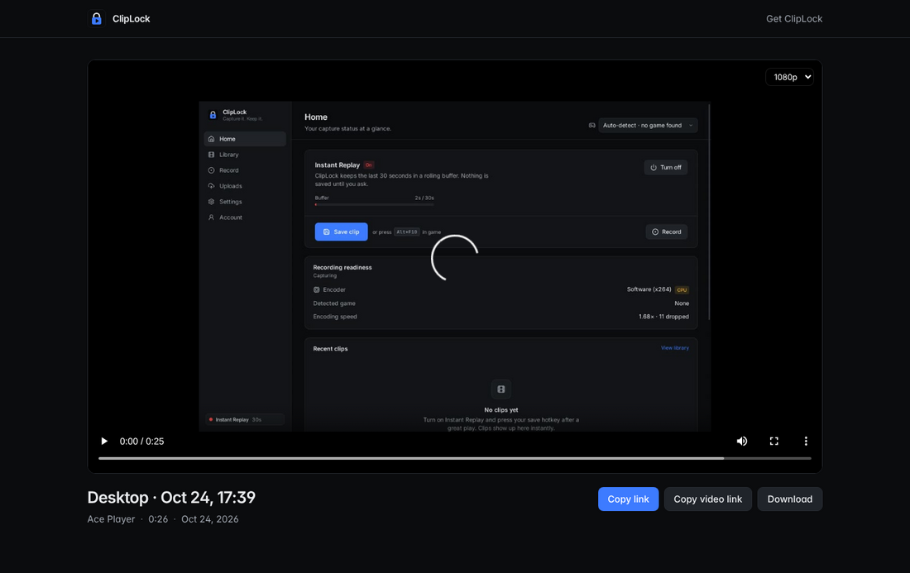

<p align="center"></p>

<h1 align="center">ClipLock</h1>
<p align="center"><b>Capture it. Keep it.</b><br>Open-source gaming clip recorder and sharing platform for Windows.</p>

<p align="center"></p>

ClipLock is a native Windows app that keeps a rolling **Instant Replay** buffer of your
gameplay, saves the last moments with a hotkey, organizes clips locally, lets you trim
and export them, and — optionally — uploads them to a **self-hostable** server that
gives every clip a share link.

> **Project status: early development (0.1).** Core features are implemented and tested
> as described in [docs/verification.md](docs/verification.md). Several things have
> **not** been verified on real hardware yet — notably GPU encoders, WASAPI audio,
> the installed Windows app, and **inline playback inside Discord**
> ([docs/discord.md](docs/discord.md)). Treat it as a developer preview.

## Features

**Recording** — Instant Replay (15 s – 5 min or custom, default hotkey **Alt+F10**) •
manual recording with pause/resume • Desktop Duplication / Windows.Graphics.Capture via
FFmpeg • NVIDIA NVENC, AMD AMF, Intel Quick Sync, Media Foundation with automatic
fallback • H.264 (HEVC/AV1 when supported) • 720p–1440p+/30–120 fps • system audio and
optional microphone with separate volumes and tracks • crash recovery • automatic game
detection

**Library & editor** — grid/list, search, game filter, sorting, favorites, rename, delete
to Recycle Bin, open file location, export • trim with frame stepping, speed
0.25×–2×, mute/volume, fast lossless trim • originals are never modified

**Sharing** — accounts, resumable background uploads, private/unlisted/public clips,
share page with link-preview metadata, direct `.mp4` links, quality selection,
downloads (optional)

**Privacy** — microphone and Instant Replay off until you enable them, visible capture
indicator, local-only mode, no telemetry, nothing uploaded without you asking.

| Library | Editor | Share |
| --- | --- | --- |
|  |  |  |

<p align="center"></p>

## Repository

```
apps/desktop      Tauri 2 desktop app — React UI + Rust core
apps/web          Next.js public clip pages, embeds, oEmbed
services/api      Fastify REST API (OpenAPI at /docs)
services/worker   FFmpeg transcoding worker
native/capture    Rust recording engine + cliplock-capture CLI
packages/shared   Shared Zod schemas and helpers
packages/ui       Design tokens and logo
infrastructure    Dockerfile, docker-compose, Caddy
docs              Architecture, Discord, self-hosting, releasing, verification
```

## Getting started

- **Use the app:** installers will be published on the
  [releases page](https://github.com/dexshii/ClipLock/releases). Until the first release,
  build it yourself ([docs/releasing.md](docs/releasing.md)); CI also produces an
  unsigned installer artifact for each successful Windows build: open
  **Actions → CI → Artifacts → cliplock-windows-installer**, download and unzip it,
  then run the included setup executable (GitHub sign-in required).
  To build locally on Windows, run `pnpm build:installer` after installing the
  [build prerequisites](docs/releasing.md#build-locally).
- **Develop:** [docs/development.md](docs/development.md)
- **Host your own server:** [docs/self-hosting.md](docs/self-hosting.md) — Docker
  Compose with PostgreSQL, MinIO (or any S3-compatible storage) and automatic HTTPS.
- **How it works:** [docs/architecture.md](docs/architecture.md)

## Requirements

Windows 10/11 64-bit with WebView2. A GPU with a hardware video encoder is strongly
recommended; software encoding works but costs CPU.

## Contributing & security

See [CONTRIBUTING.md](CONTRIBUTING.md) and [SECURITY.md](SECURITY.md).

## License

[MIT](LICENSE). The Windows app bundles LGPL FFmpeg executables — see
[THIRD_PARTY_NOTICES.md](THIRD_PARTY_NOTICES.md). ClipLock is not affiliated with
Discord, Medal or Outplayed.
